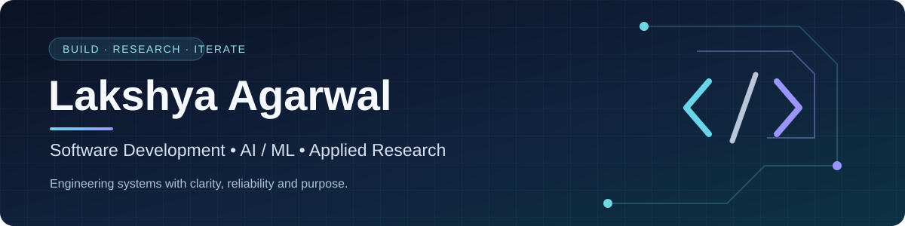
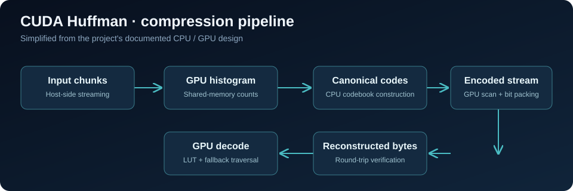
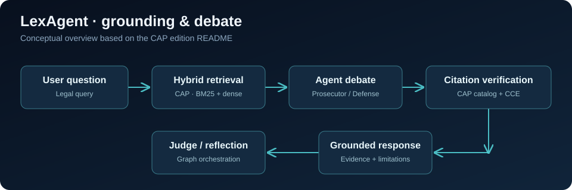
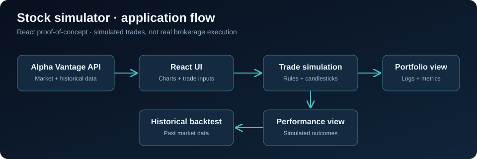

### Hey, I'm Lakshya 👋

**Systems & GPU Computing · Full-Stack Development · Applied AI Research**

*Curious about how code, electronics, and physical machines come together.*

---

### A little about me

I'm a **final-year B.Tech student in Electronics and Computer Engineering at VIT Chennai**, with a **9.20 CGPA**.

Why this degree? The simplest answer is **restless curiosity**: I've always wanted to know how things work. How does the code we write tell electronic chips what to do? How do those chips understand and carry out instructions, and how can their electrical signals eventually control motors, mechanisms, and entire machines? I've always been fascinated by the connection between a few lines of software and something actually happening in the physical world.

I don't have all the answers yet. Every time I learn something, I seem to find another question worth asking. That's part of the fun. I don't think learning ends with a degree.

I enjoy building software, testing ideas, and understanding not just **how** something works, but **why** it works that way.

### What I'm exploring

- **Systems & performance:** C++, CUDA, parallel algorithms, memory movement, and benchmarking
- **Software engineering:** Python, JavaScript, React, REST APIs, and backend design
- **AI & research:** RAG, multi-agent systems, retrieval, evaluation, and explainability
- **Cloud & deployment:** AWS and taking applications beyond the local machine

### Featured projects

<table>
<tr>
<td width="50%" valign="top">

#### [⚡ CUDA Huffman Compression](https://github.com/lakkki12/huffman-cpu-vs-gpu)

**Systems programming · Parallel computing**

Implemented CPU and CUDA pipelines for canonical Huffman compression/decompression, including GPU frequency counting, block offsets, encoding, and decoding. Examines performance alongside end-to-end correctness.

**Why I built it:** My Computer Architecture course sparked a curiosity about how GPUs actually work. Discovering CUDA led me to use Huffman coding as a hands-on way to explore parallel execution.

**Discussion points:** CPU/GPU division of work, memory transfers, compression format, and benchmarking methodology.

`C++` `CUDA` `Algorithms`

[Code and architecture →](https://github.com/lakkki12/huffman-cpu-vs-gpu)

</td>
<td width="50%" valign="top">

#### [⚖️ LexAgent](https://github.com/lakkki12/MultiAgent-Debate-Framework-for-Hallucination-Reduction-in-Legal-Al)

**AI engineering · Research-oriented evaluation**

Built a legal AI framework using hybrid case-law retrieval, structured multi-agent debate, and citation checks to study how answers can be better grounded in source material.

**Why we built it:** Reading about fabricated case citations submitted in a US courtroom made us wonder whether a multi-agent approach could improve legal AI grounding—even if verification added latency.

**Discussion points:** BM25 + dense retrieval, agent orchestration, citation verification, and ablation experiments.

`Python` `LangGraph` `RAG` `LLMs`

[Code and experiments →](https://github.com/lakkki12/MultiAgent-Debate-Framework-for-Hallucination-Reduction-in-Legal-Al)

</td>
</tr>
</table>

<table>
<tr>
<td valign="top">

#### [📈 Stock Trading Simulator](https://github.com/lakkki12/STOCK_TRADER)

**Frontend engineering · API integration**

Developed a React proof-of-concept for market charts, simulated orders, portfolio tracking, and historical backtesting using Alpha Vantage market data.

**Why I built this:** I wanted to explore how stock trading works beyond just looking at price charts. I built this simulator to experiment with market data, candlestick patterns, and trading strategies without risking real money. It also gave me a practical way to work with REST APIs, React, and financial data while understanding how trading decisions affect simulated profits and losses.

**Discussion points:** component structure, API data handling, simulated trade logic, and backtesting assumptions.

`React` `JavaScript` `REST APIs`

[Explore application →](https://github.com/lakkki12/STOCK_TRADER)

</td>
</tr>
</table>

### Behind the projects · architecture at a glance

These are **simplified conceptual diagrams** based on the repositories' documented pipelines—not claims of production deployment. Follow each project's code and documentation for implementation details.

**CUDA Huffman — CPU/GPU compression and round-trip decoding**

**LexAgent — case-law retrieval, debate, and citation grounding**

**Stock Trading Simulator — market data to simulated portfolio results**

### Technical toolkit

**Languages and computing**

**Frameworks, cloud, and development**

### How I work with AI

I use AI as a development tool, and I'm open about it.

Sometimes it's a brainstorming partner; sometimes it handles boilerplate or repetitive implementation work. When I'm busy, I may also describe the architecture and requirements in detail and let AI generate a larger portion of the implementation. I then review what it produced, question its decisions, and fix or improve what needs attention.

I don't think engineering is measured by how many lines you type yourself. Understanding the system, being able to explain the trade-offs, and checking that the code actually works matter much more. AI can move things along quickly, but it can also be confidently wrong—so generated code still needs judgment and verification.

### Research and publications

**[A deep hybrid CNN-BiLSTM-BiGRU architecture with explainability for mild cognitive impairment detection using EEG](https://doi.org/10.1186/s40708-026-00302-4)**

Aishik Tokdar, **Lakshya Agarwal**, Shataghnee Chatterjee, and Sukriti  
*Brain Informatics* · Springer Nature · 2026

Research on an explainable deep-learning architecture for EEG-based mild cognitive impairment detection.

[Read paper ↗](https://doi.org/10.1186/s40708-026-00302-4) · [PubMed ↗](https://pubmed.ncbi.nlm.nih.gov/42108320/)

### Published Indian patent applications

Both applications list **Vellore Institute of Technology, Chennai** as the applicant. These are **published applications, not granted patents**.

| Innovation | Application number | Filed | Published | Current status |
| --- | --- | --- | --- | --- |
| **[System for Orchestrated Control of Physical Infrastructure](patents/physical-infrastructure-control.md)** | `202641106171` | 03 Sep 2026 | 11 Sep 2026 | Under Examination |
| **[System and Method for Autonomous Aquatic Environmental Clean-Up and Waste Management](patents/aquatic-cleanup.md)** | `202541076812` | 12 Aug 2025 | 05 Sep 2025 | Awaiting Examination |

*Both are ordinary applications. Examination requests were filed on 11 Sep 2026 and 12 Aug 2025, respectively. Statuses reflect the supplied application records and may change.*

---

### Beyond the code ⚽ 🎮

Football is my way of staying active and taking a break from screens. When I want to escape into another world, I play games. I've finished **GTA V**, **Dishonored**, **Shadow of the Tomb Raider**, and **Hogwarts Legacy**.

Also, I don't drink coffee, tea, or energy drinks. Apparently, I missed that part of the developer onboarding process. Somehow, the code still runs.

---

### Let's connect

Happy to talk about software engineering, GPU computing, AI, electronics, or an interesting technical problem.

[**Email**](mailto:lakshyaagarwalbly16@gmail.com) · [**LinkedIn**](https://www.linkedin.com/in/lakshyaagarwal12/) · [**Repositories**](https://github.com/lakkki12?tab=repositories)

Still curious. Still learning. Still figuring things out.

