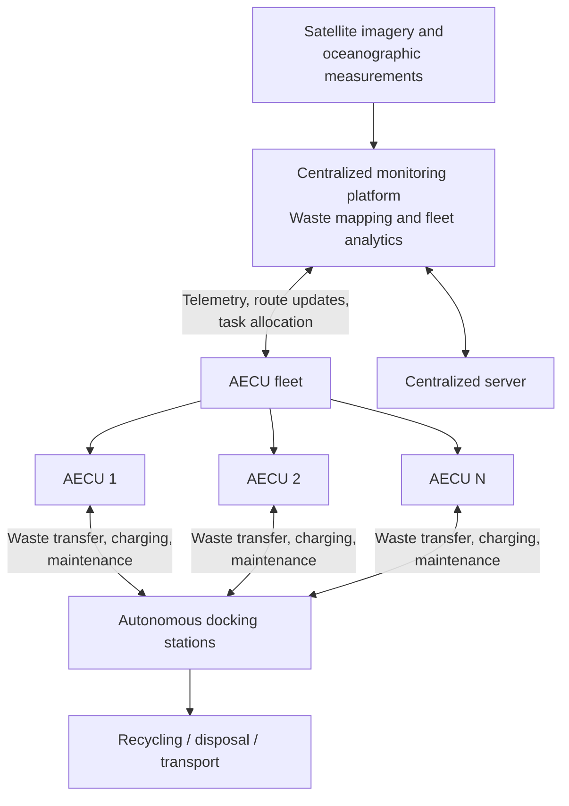
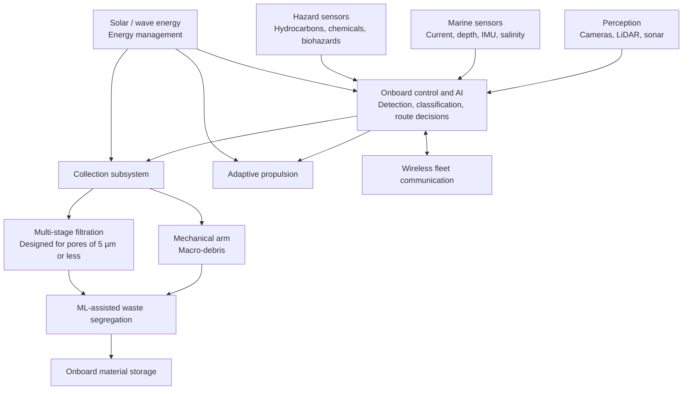

# Patent Architecture — Autonomous Aquatic Environmental Clean-Up and Waste Management

> **Published Indian patent application** · Application No. **202541076812** · Publication No. **36/2025** · Publication date **5 September 2025** · Filed **12 August 2025** · Type **INA** · Field **Electronics**

## Overview

The disclosed system coordinates a fleet of **Aquatic Environmental Cleanup Units (AECUs)** to detect, collect, classify and transfer aquatic waste. The architecture combines onboard perception and edge control with fleet-level monitoring, renewable power and autonomous docking.

**Scope:** This is an explanatory architecture derived from the published application description. Capabilities such as 5-micron filtration and autonomous fleet operation are design features described in the application, not independently verified performance results.

## Fleet-level system architecture

## Architecture of an individual AECU

## Main subsystems

| Subsystem | Role |
| --- | --- |
| AI-driven sensing | Detects floating or submerged debris using camera, LiDAR and sonar input. |
| Environmental sensing | Monitors currents, orientation, salinity, temperature and other aquatic conditions. |
| Edge control | Supports local decisions and dynamic operation when connectivity is limited. |
| Waste collection | Uses mechanical collection for macro-debris and multi-stage filtration for microplastics. |
| Waste segregation | Sorts collected materials into categories such as plastic, metal and organic matter. |
| Fleet intelligence | Adjusts cleaning routes and task assignments from debris density and operating conditions. |
| Renewable energy | Combines solar and wave energy with onboard energy management. |
| Docking stations | Support waste offloading, recharging and maintenance. |

## Intended operational sequence

1. Deploy AECUs into a target aquatic region.
2. Observe the environment and locate waste using onboard sensors.
3. Select collection methods for identified waste types.
4. Collect, classify and segregate waste onboard.
5. Share telemetry and update routes across the fleet.
6. Return to docking stations for unloading and servicing.

## Engineering themes

**Autonomous robotics · computer vision · marine sensing · edge AI · swarm coordination · renewable energy · environmental technology**

*Patent metadata is based on the publication details supplied by the applicant. This page is a high-level, non-legal technical summary; it does not reproduce the patent's official drawings or establish grant status.*
