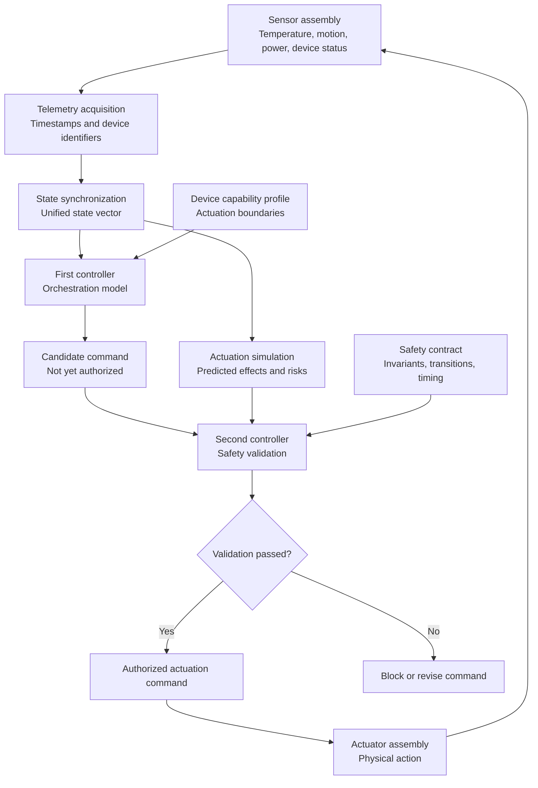

# Patent Architecture — Orchestrated Control of Physical Infrastructure

> **Published Indian patent application** · Application No. **202641106171** · Publication No. **37/2026** · Publication date **11 September 2026** · Type **INA**

## Overview

The disclosed system coordinates physical infrastructure devices through synchronized telemetry and a two-stage control process. A first controller proposes actions; a separate safety controller checks those actions against actuator-specific safety contracts before physical execution.

**Scope:** This is an explanatory architecture derived from the published application description. It represents disclosed functionality, not proof that every component has been implemented or deployed.

## System architecture

## Main components

| Component | Role |
| --- | --- |
| Sensor assembly | Captures telemetry about environmental and device conditions. |
| State synchronization unit | Aligns telemetry by timestamps and builds a unified state vector. |
| Orchestration controller | Determines candidate actions based on state and device capabilities. |
| Actuation simulation unit | Estimates prospective results and execution risks. |
| Safety controller | Validates proposed actions against independent safety constraints. |
| Actuator assembly | Performs only authorized physical actions. |

## Example control sequence

1. Sensors capture device status and environmental readings.
2. The controller synchronizes inputs into a current infrastructure state.
3. The orchestration model proposes a command, such as changing a device state.
4. A separate safety controller checks permissions, state transitions, timing constraints and, where applicable, predicted risks.
5. The system either blocks the proposal or issues an authorized command to the actuator.
6. New telemetry feeds the next decision cycle.

## Engineering themes

**Cyber-physical systems · IoT telemetry · state synchronization · deterministic safety validation · controlled actuation · automation**

*Patent metadata is based on the publication details supplied by the applicant. This page is a high-level, non-legal technical summary; it does not reproduce the patent's official drawings or establish grant status.*
