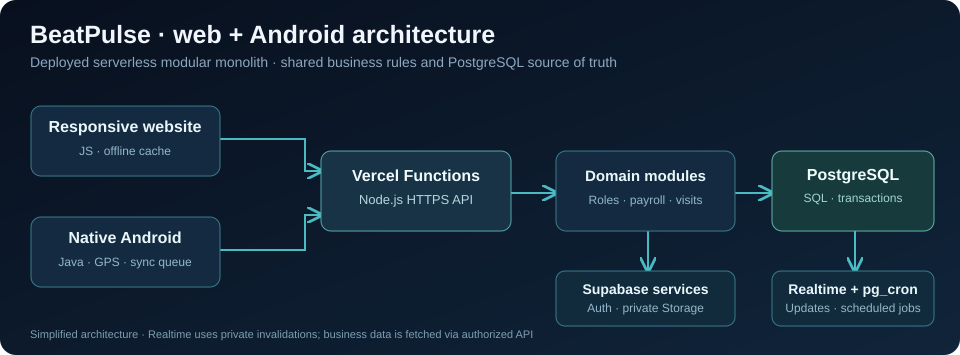

# BeatPulse — AI-assisted workforce management platform

**Product design · System architecture · Full-stack development · AI-assisted engineering**

BeatPulse is an attendance, payroll, and field-work management platform built for the day-to-day operations of a real business. It provides a responsive website for administrative work and a native Android application for field employees. Both clients share one authenticated backend and a PostgreSQL database.

**Status:** Deployed and used in a real business. This page is a public, high-level project explanation; the production source repository and business data remain private.

## My role and how I used AI

I conceived the product, designed the architecture, defined the workflows and requirements, and made the key technical decisions. I used **OpenAI Codex** as an AI coding assistant to generate implementation code and accelerate delivery rather than writing all code manually. The objective was to ship a working business application faster while keeping the product and architecture decisions under my direction.

AI-assisted implementation is distinct from embedding an LLM inside the product: BeatPulse is a workforce management application, **not** an LLM-powered application.

## What it does

- **Attendance and shifts:** Employee punch-in/out, shift rules, corrections, automated shift closure, and geofence-related checks.
- **Payroll and leave:** Salary and incentive calculations, reviewed settlements, leave requests, and holiday policies.
- **Field operations:** Shop assignments, recurring work schedules, visits, GPS-based verification, and photo-based review when needed.
- **Role-based workspaces:** Views and permissions for administrators, accountants, and field employees.
- **Live updates:** Clients receive private change notifications and reload authorized data through the API.
- **Offline support:** Supported field tasks can be stored in encrypted local queues and reconciled later; attendance requires an online server decision.
- **Reporting and audit:** Exports, operational history, and review trails.

## Technology stack

| Layer | Technology |
| --- | --- |
| Native Android app | Java 17, Android Views, AndroidX, Material Components |
| Android networking and device tasks | OkHttp, WorkManager, Google Fused Location Provider |
| Web application | HTML, CSS, vanilla JavaScript ES modules, service worker, IndexedDB |
| Maps | Leaflet, OpenStreetMap |
| Backend | Node.js, HTTPS/JSON APIs, Vercel Functions |
| Production database | Supabase PostgreSQL, SQL / PLpgSQL functions, PostgREST RPC |
| Identity, files, live updates | Supabase Auth, private Storage, Realtime |
| Scheduling | PostgreSQL `pg_cron`, Vercel scheduled maintenance |
| Local development | Node.js, SQLite |
| Quality and testing | Node test runner, JUnit, Robolectric, PGlite, ESLint, Gradle |

## Architecture at a glance

The system is a **serverless modular monolith**, not a fleet of separately deployed microservices:

1. The responsive website and native Android application communicate with a shared Node.js HTTPS API deployed on Vercel.
2. The API checks identity, permissions, and business rules before performing authorized operations.
3. Domain modules coordinate transactional work in Supabase PostgreSQL, including SQL functions for sensitive multi-record operations.
4. Supabase Auth handles identity, private Storage holds authorized files, and private Realtime channels signal changes without broadcasting sensitive records.
5. Scheduled jobs handle recurring database maintenance. Local encrypted queues support selected offline work; sync is reconciled against server decisions.

### Why this design?

- **One source of truth:** PostgreSQL owns authoritative business records and transactional decisions across both clients.
- **Consistent permissions:** Role- and ownership-aware checks are enforced at the backend/database boundary, not only in the UI.
- **Practical offline behavior:** Queued work is not treated as accepted until the server confirms it.
- **Modular delivery:** Compatible backend changes can be deployed independently of Android APK releases.
- **Operational safety:** Private evidence, encrypted local state, auditing, and guarded business transitions are important design constraints.

## Testing and engineering considerations

The project uses automated backend, web, database, and Android checks, alongside release validation. Device-specific behaviors—such as GPS accuracy, background restrictions, and network reliability—also require testing on physical phones.

A key lesson was designing reliable behavior across two clients, intermittent connectivity, and business-critical state changes while using AI-assisted implementation responsibly.

## Availability and privacy

This page intentionally explains the project without linking to the private source repository, production dashboard, or Android installer. It does not include credentials, customer records, employee data, private GPS records, or internal operational documents.

[← Back to GitHub profile](../README.md)
